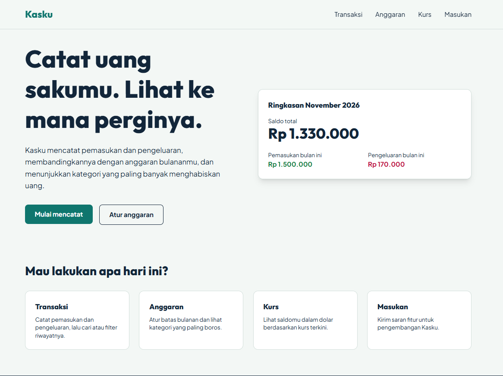
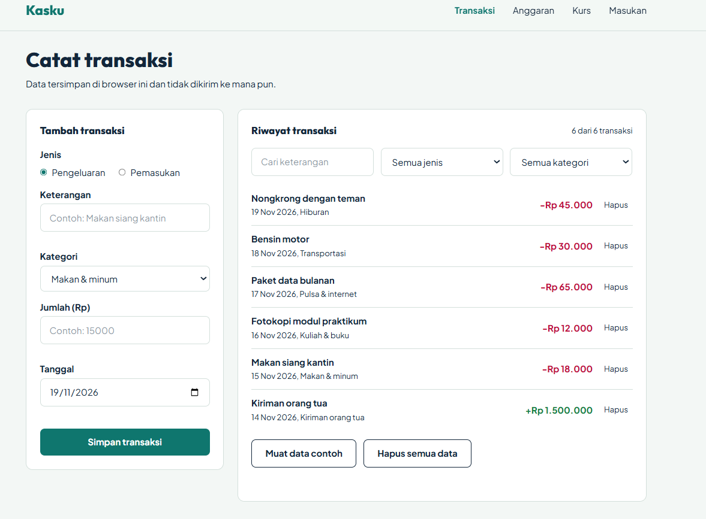
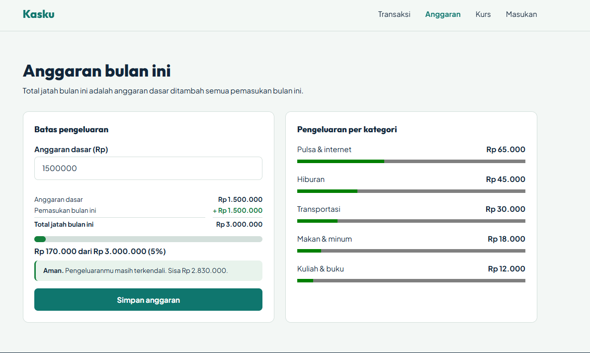
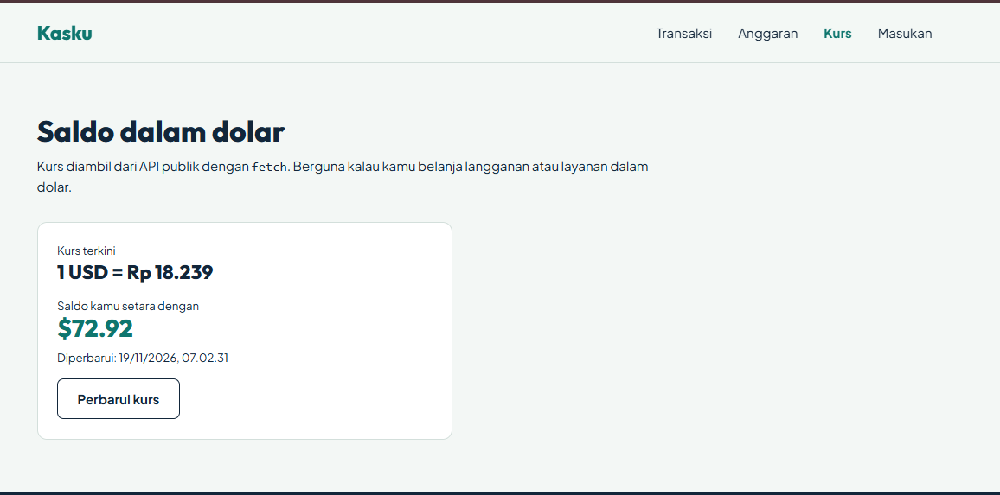
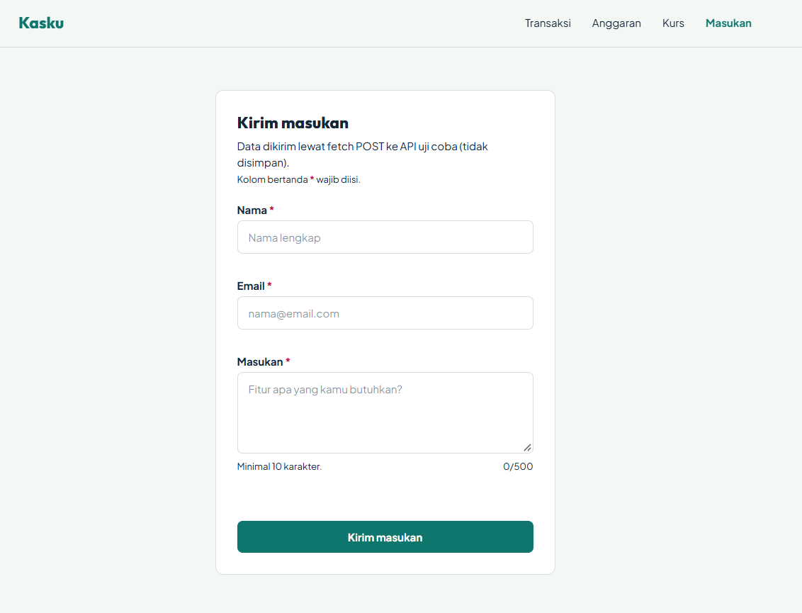

# Kasku - Pencatat Uang Saku Mahasiswa

Aplikasi web multi-halaman untuk mencatat pemasukan dan pengeluaran uang saku, memantau anggaran bulanan, dan melihat saldo dalam dolar. Dibuat untuk **Praktikum Pemrograman Web (Modul 1 dan Modul 2)**, Informatika, Universitas Muhammadiyah Malang.

> Kasku **memakai** (consume) API, bukan membuat API sendiri. Tidak ada backend: data transaksi disimpan di `localStorage` browser.

## Fitur

| Halaman | File | Isi |
|---|---|---|
| Beranda | `index.html` | Ringkasan bulan ini, tautan ke halaman lain, cara memakai |
| Transaksi | `transaksi.html` | Tambah, cari, filter, hapus transaksi; muat data contoh dari file JSON |
| Anggaran | `anggaran.html` | Atur anggaran dasar, bilah pemakaian berwarna, rincian per kategori |
| Kurs | `kurs.html` | Saldo dalam USD dari API publik kurs |
| Masukan | `masukan.html` | Formulir masukan dengan validasi per kolom dan kirim lewat fetch POST |

## Teknologi

- HTML5 semantik
- Tailwind CSS v4 (lewat NPM, `@theme`, `@layer`)
- JavaScript ES Modules (tanpa framework)
- Fetch API: GET (JSON lokal dan API publik) dan POST (API uji coba)

## Struktur Folder

```
kasku/
├── package.json
├── README.md
├── .gitignore
├── docs/                      <- taruh screenshot di sini
└── src/
    ├── index.html  transaksi.html  anggaran.html  kurs.html  masukan.html
    ├── main.css               <- sumber Tailwind (token tema + komponen)
    ├── output.css             <- hasil build (dibuat otomatis)
    ├── data/contoh.json       <- data contoh untuk fetch GET lokal
    └── js/
        ├── page-*.js          <- satu titik masuk per halaman
        ├── nav.js             <- navbar toggle
        ├── ledger.js          <- form + daftar transaksi
        ├── summary.js         <- initHero (beranda) dan initBudget (anggaran)
        ├── sample.js          <- muat data contoh (Promise.all)
        ├── kurs.js            <- kurs USD (async/await)
        ├── feedback.js        <- form masukan + validasi
        ├── api.js             <- semua pemanggilan fetch
        ├── store.js           <- state bersama (subscribe/dispatch)
        ├── storage.js         <- localStorage + validasi bentuk data
        ├── utils.js           <- fungsi murni (hitung, filter, validasi)
        ├── data.js            <- konstanta kategori
        └── dom.js             <- helper $, $$, el
```

## Cara Menjalankan

Prasyarat: Node.js 18+ dan VS Code dengan ekstensi **Live Server**.

```bash
npm install
npm run dev        # build Tailwind dan pantau perubahan (biarkan terminal terbuka)
```

Lalu klik kanan `src/index.html` -> **Open with Live Server**.

> Wajib lewat server (Live Server). Membuka file langsung (`file://`) membuat `type="module"` dan `fetch` gagal karena kebijakan CORS.

Build sekali untuk produksi: `npm run build`.

---

## Penerapan HTML

| Konsep | Penerapan | Lokasi |
|---|---|---|
| Struktur dokumen | `<!doctype html>`, `lang="id"`, `<meta viewport>`, `<title>` per halaman | semua `*.html` |
| Elemen semantik | `<header>`, `<nav>`, `<main>`, `<section>`, `<footer>` | semua halaman |
| `<article>` dan `<aside>` | Kartu informasi dan panel samping | `index.html` |
| Formulir | `<form>`, `<label for>`, `<input>` (text, number, date, email), `<select>`, `<textarea>`, `<fieldset>` | `transaksi.html`, `anggaran.html`, `masukan.html` |
| Atribut validasi | `required`, `min`, `step`, `maxlength`, `type="email"`, `novalidate` (pesan error ditangani JS) | form di atas |
| Daftar | `<ul>`, `<li>`, `<menu>`, `<dl>/<dt>/<dd>` (rincian jatah anggaran) | `transaksi.html`, `anggaran.html` |
| `<progress>` | Porsi tiap kategori terhadap total pengeluaran | dibuat di `summary.js` (`initBudget`) |
| Aksesibilitas | skip link, `aria-label`, `aria-expanded`, `aria-controls`, `aria-current="page"`, `aria-live`, `role="alert"`, `role="status"`, `role="progressbar"`, kelas `sr-only` | semua halaman |
| Navigasi multi-halaman | Tautan relatif antar file `.html` | `<nav>` di semua halaman |

## Penerapan CSS (Tailwind v4)

| Konsep | Penerapan | Lokasi |
|---|---|---|
| Impor Tailwind | `@import "tailwindcss";` | `src/main.css` |
| Design token | `@theme { --color-ink, --color-teal, --color-income, --color-expense, --color-warn, --color-paper, --color-line, --font-display, --font-sans }` | `src/main.css` |
| Layer base | gaya dasar `body`, `:focus-visible`, `prefers-reduced-motion` | `@layer base` |
| Layer components | `.btn-primary`, `.btn-outline`, `.section`, `.card`, `.field`, `.badge`, `.chip` dengan `@apply` | `@layer components` |
| Responsif mobile-first | `grid-cols-1 md:grid-cols-2`, `flex-col md:flex-row`, `hidden md:flex` | semua halaman |
| Varian state | `hover:`, `focus:`, `disabled:`, `aria-[current=page]:`, `aria-invalid:` | `main.css` dan HTML |
| Utilitas layout | `grid`, `flex`, `gap-*`, `max-w-6xl mx-auto`, `sticky top-0` | semua halaman |
| Mengubah tema (Codelab) | cukup ganti nilai di blok `@theme`, seluruh halaman ikut berubah | `src/main.css` |

## Penerapan JavaScript

| Konsep Modul 2 | Penerapan | Lokasi |
|---|---|---|
| ES Modules | `<script type="module">`, `import`/`export` | semua `js/*.js`, tag script tiap halaman |
| Function (3 gaya) | declaration (`escapeHTML`), expression (`log`), arrow (hampir semua fungsi `utils.js`) | `utils.js` |
| Template literal | `` `${formatRupiah(x)} dari ${...}` `` | `summary.js`, `kurs.js`, `ledger.js` |
| Destructuring | `({ desc, amount, date })`, `const [rows] = await ...` | `utils.js`, `sample.js` |
| Spread dan rest | `[...txs, tx]`, `{ ...filters, type }`, `(base, ...others)`, `log(level, ...messages)` | `utils.js`, `ledger.js` |
| Array method | `map`, `filter`, `find`, `reduce`, `sort`, `forEach`, `flat` | `utils.js` (`summarize`, `spentByCategory`, `sortTx`, `filterTx`, `mergeUnique`) |
| Immutability dan pure function | semua operasi data mengembalikan array/objek **baru** | `utils.js` |
| Selektor DOM | `querySelector`, `querySelectorAll` dibungkus `$`, `$$` | `dom.js` |
| Membuat elemen | `createElement`, `setAttribute`, `append` dibungkus `el()` | `dom.js`, `ledger.js` |
| Mengubah tampilan | `textContent`, `classList`, `hidden`, `style.width`, `className` | `summary.js`, `ledger.js` |
| Event handling | `click`, `submit`, `input`, `change`, `keydown`, `focusout` | `nav.js`, `ledger.js`, `feedback.js`, `summary.js` |
| Event delegation | satu listener di `<ul id="tx-list">` untuk semua tombol Hapus | `ledger.js` |
| Navbar toggle (Codelab) | tombol menu membuka/menutup, `Escape` menutup, `aria-expanded` ikut berubah | `nav.js` |
| Validasi form (Codelab) | pesan error per kolom, `aria-invalid`, fokus ke kolom salah pertama | `utils.js` (`validateTx`), `feedback.js` (`validateFeedback`) |
| Pencegahan XSS | teks pengguna lewat `textContent`; bila ke `innerHTML` dilewatkan `escapeHTML()` | `utils.js`, `dom.js`, `summary.js` |
| Web Storage | `localStorage` + `JSON.parse` dalam `try/catch` + cek bentuk data (`isTx`) | `storage.js` |
| State terpusat | pola observer: `getState`, `subscribe`, `dispatch` | `store.js` |
| Asynchronous | Promise, `setTimeout` (`wait`), `async/await`, `Promise.all`, `try/catch/finally` | `api.js`, `sample.js`, `kurs.js`, `feedback.js` |

## Penerapan API (Fetch API)

Semua pemanggilan ada di **`js/api.js`**. Fungsi `request()` memeriksa `response.ok` secara manual, karena `fetch` hanya menolak promise saat jaringan gagal, bukan saat status 404/500.

| Method | Endpoint | Fungsi | Dipakai di | Keterangan |
|---|---|---|---|---|
| GET | `./data/contoh.json` | `getSample()` | `sample.js` (tombol Muat data contoh) | File JSON lokal, digabung tanpa id ganda dengan `mergeUnique` |
| GET | `https://open.er-api.com/v6/latest/USD` | `getUsdRate()` | `kurs.js` | API publik tanpa kunci; bentuk respons diperiksa sebelum dipakai |
| POST | `https://jsonplaceholder.typicode.com/posts` | `sendFeedback()` | `feedback.js` | `JSON.stringify` + header `Content-Type`; API uji coba, **data tidak tersimpan** |

Penanganan status tampilan (syarat Codelab Modul 2):

- **Loading**: tombol dinonaktifkan dan teks "Memuat..." / "Mengirim..." tampil (`sample.js`, `kurs.js`, `feedback.js`).
- **Error**: `TypeError` dibedakan sebagai masalah jaringan, sedangkan status HTTP salah menampilkan kode statusnya.
- **Sukses**: data dirender ke kartu/daftar (`kurs.js`, `ledger.js`).
- **`finally`**: tombol selalu aktif kembali, berhasil maupun gagal.

### Alur data

```
Form / tombol  --event-->  ledger.js / summary.js
                               |  dispatch({ transactions | budget })
                               v
                           store.js  --subscribe-->  render() tiap halaman
                               |
                               v
                          storage.js  <-->  localStorage

api.js (fetch)  -->  sample.js / kurs.js / feedback.js  -->  DOM (loading, error, hasil)
```

Karena state disimpan di `localStorage`, transaksi yang ditambah di halaman Transaksi langsung terlihat di Beranda, Anggaran, dan Kurs.

## Pemetaan Materi Praktikum

**Modul 1**

| Topik | Di mana |
|---|---|
| HTML semantik | Penerapan HTML di atas |
| Form dan atribut input | `transaksi.html`, `masukan.html`, `anggaran.html` |
| Tailwind via NPM | `package.json`, `src/main.css` |
| `@theme` dan design token | `src/main.css` |
| Responsif (mobile-first) | kelas `md:` di semua halaman |
| Codelab: ubah tema | ganti nilai `@theme` |
| Codelab: isi card | kartu di `index.html` |

**Modul 2**

| Topik | Di mana |
|---|---|
| Fungsi, template literal, destructuring, spread/rest | `utils.js` |
| Array method | `utils.js` |
| DOM dan event | `ledger.js`, `nav.js` |
| Asynchronous (Promise, async/await) | `api.js`, `sample.js`, `kurs.js` |
| REST API dan Fetch (GET, POST) | `api.js` |
| Codelab: navbar toggle dan validasi form | `nav.js`, `feedback.js` |
| Codelab: fetch GET + loading + error | `kurs.js`, `sample.js` |
| Demo: event >= 2 jenis, search, filter, template literal, array method | `ledger.js` (`input`, `change`, `submit`, `click`) |

## Keterbatasan

- Tidak ada backend; data hanya ada di browser pemiliknya dan hilang jika data situs dihapus.
- JSONPlaceholder hanya menyimulasikan POST: respons sukses, tetapi data tidak benar-benar disimpan.
- Kurs bergantung pada layanan pihak ketiga; jika offline, halaman Kurs menampilkan pesan error.

## Rencana Pengembangan

- Ekspor transaksi ke CSV
- Grafik pengeluaran per kategori
- Backend sendiri (Node/Express) untuk menggantikan `localStorage`
- Autentikasi pengguna

## Tangkapan Layar

### Beranda


### Transaksi


### Anggaran


### Kurs


### Masukan


## Pembuat

Susilo Adi Nugroho - 202410370110001 - Informatika, Universitas Muhammadiyah Malang
